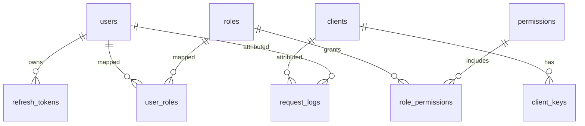

# Database

## Core Tables
- users, roles, permissions, user_roles, role_permissions
- clients, client_keys
- refresh_tokens
- gateway_routes, service_registry
- audit_logs, rate_limits, api_logs, request_logs

## ER Diagram

